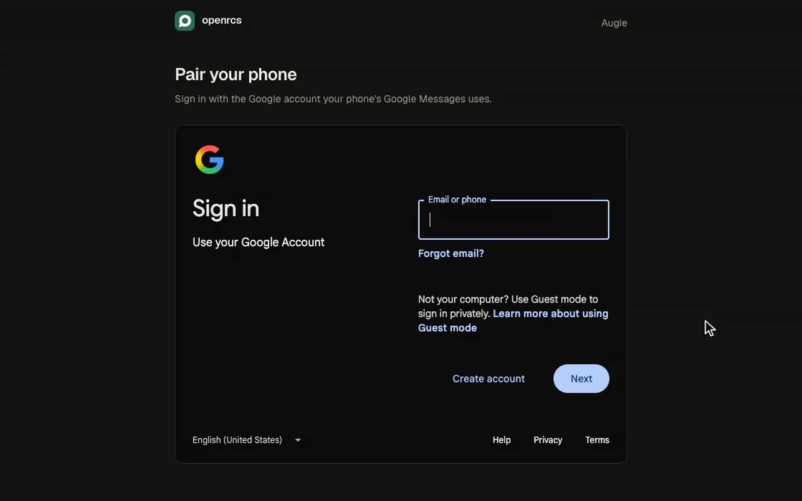

<p align="center">
  
</p>

<h1 align="center">openrcs</h1>

<p align="center">
  Your Android phone's texts (SMS and RCS), available to your AI agents over MCP.<br>
  Self-hosted in one Docker container, reachable only over your tailnet.
</p>

<p align="center">
  <a href="docs/media/demo.mp4">
    
  </a>
</p>

## Quick start

On a Docker host that's on your tailnet (MagicDNS and HTTPS certificates on):

```sh
git clone https://github.com/AugusDogus/openrcs && cd openrcs
cp .env.selfhost.example .env      # set OPENRCS_URL=https://<machine>.<tailnet>.ts.net:5443
docker compose up -d --build
tailscale serve --bg --https=5443 http://127.0.0.1:5480
```

Open that address, sign in to Google in the browser on the page, and tap the
emoji on your phone. Then add `https://<machine>.<tailnet>.ts.net:5443/api/mcp`
to your agent, for example:

```sh
claude mcp add --transport http openrcs https://<machine>.<tailnet>.ts.net:5443/api/mcp
```

## Docs

- [Self-hosting](docs/self-hosting.md): Unraid, settings, backups, updates, troubleshooting
- [Agents](docs/agents.md): setup for Codex, OpenCode, Executor and others, and the tools
- [Security](docs/security.md): what's encrypted, and what a copy of the data folder reveals
- [Development](docs/development.md) and [architecture](docs/architecture.md)

AGPL-3.0. The Google Messages protocol is a TypeScript port of libgm from
[mautrix-gmessages](https://github.com/mautrix/gmessages); see [NOTICE](NOTICE).
